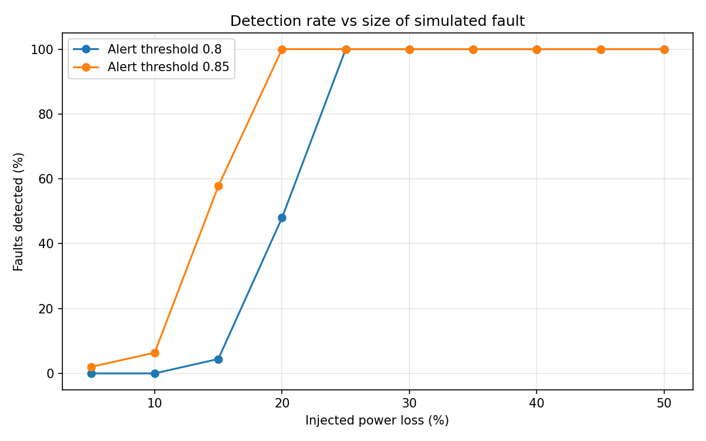
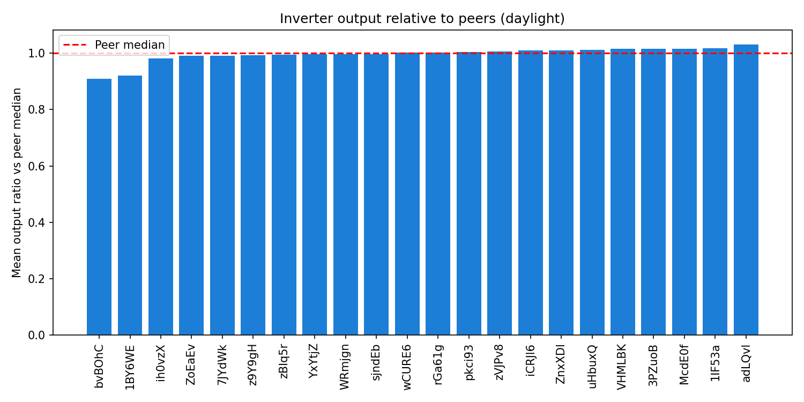
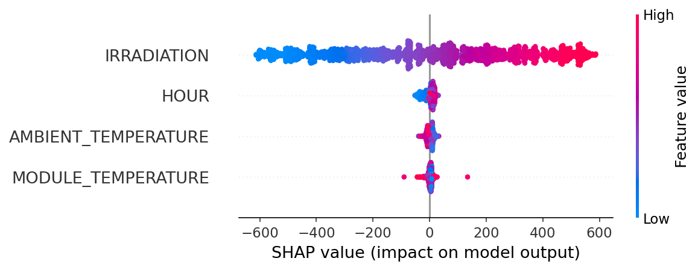

# ☀️ Solar Inverter Underperformance Detector

Detects solar inverters that produce less power than the weather justifies, using an XGBoost "expected power" model validated with peer comparison and simulated faults.

**Live demo:** _coming soon_



## Problem

A solar plant has many inverters sharing the same sunshine. When one quietly produces less than it should (dust, shading, derating, a faulty string), the loss often goes unnoticed because total output still looks plausible. This project estimates how much power a **healthy** inverter should produce for the current weather and time of day, and raises an alert when actual output falls well below it.

An alert means *lower than expected*. It does not prove a specific hardware fault.

## What the app does

- **Single reading:** enter weather and actual power, get expected power, the ratio and an alert, with real example readings to start from.
- **Batch analysis:** upload telemetry for one or many inverters, get a per-inverter summary, an actual-vs-expected chart and a downloadable list of flagged readings.
- **Adjustable alert threshold**, with the trade-off between catching small faults and false alarms explained below.

## Data

Public Kaggle dataset: [Solar Power Generation Data (Plant 1)](https://www.kaggle.com/datasets/anikannal/solar-power-generation-data). It has 22 inverters, 34 days (15 May to 17 Jun 2020) and 15-minute readings: 68,778 generation rows and 3,182 weather-sensor rows. The raw files are not included in this repository.

Both files were loaded into SQLite and joined on timestamp with SQL. After keeping daylight readings and valid peer comparisons, 31,022 rows were used for modelling.

## Approach

**1. Labels from peer comparison (no model involved).**
All inverters see the same sky, so an inverter whose 1-hour median output falls below 80% of the median of its peers at the same time is labelled underperforming. This gave 0.35% positive rows. The share is stable between thresholds 0.70 and 0.80 (0.30% to 0.35%).



Two inverters (`bvBOhCH3iADSZry`, `1BY6WEcLGh8j5v7`) run chronically about 8-9% below their peers (mean ratio 0.908 and 0.921). Every other inverter is within a few percent of 1.0.

**2. Expected-power model, trained only on healthy data.**
Features are irradiation, ambient temperature, module temperature and time of day. Training excludes flagged rows and the two chronically weak inverters. Train and test sets are split chronologically (train 15 May to 11 Jun, 22,533 rows; test 11 to 17 Jun, 5,617 rows), and models are compared with time-series cross-validation.

| Model | CV MAE (kW) | Test MAE (kW) | Test RMSE (kW) | Test R² |
|---|---|---|---|---|
| Linear (irradiation only) | 46.6 | 43.1 | 57.1 | 0.965 |
| Linear (4 features) | 47.1 | 43.5 | 57.3 | 0.964 |
| Random Forest | 44.6 | 30.6 | 47.8 | 0.975 |
| **XGBoost** | **41.8** | **27.3** | **43.9** | **0.979** |

XGBoost cuts test MAE by about 37% against the irradiation-only baseline. The gain is smaller in cross-validation (about 10%), because early folds train on only a few days. SHAP shows irradiation dominates, with time of day second and the temperatures third.



**3. Validation with simulated faults.**
The model never sees peer data, so I checked that it still finds underperformance. Without peers it rates the two weak inverters at 0.888 and 0.898 of expected output, and every other inverter at 0.99 or higher, agreeing with the peer-based finding.

For a test independent of the peer labels, I injected constant power losses lasting 2 hours into random inverter-days of held-out healthy data (about 40-50 events per loss level) and measured how many the detector catches:

| Power loss | Detected (threshold 0.80) | Detected (threshold 0.85) |
|---|---|---|
| 10% | 0% | 2% |
| 15% | 7% | 56% |
| 20% | 52% | 100% |
| 30% | 100% | 100% |
| 50% | 100% | 100% |

False-alarm rate on clean held-out rows: 0.00% at 0.80 and 0.11% at 0.85. Results vary by a few points between random runs. The default threshold is **0.85**, which catches every sustained loss of 20% or more. A fault is detected roughly when its loss exceeds `1 - threshold`, since normal variation is a few percent.

## Limitations

- One plant, 34 days; the test period is about 6 days. Rows from different inverters at the same timestamp share weather, so they are not independent samples.
- Faults in the detection test are simulated (constant loss, 2 hours), not confirmed real failures. The false-alarm rate is probably optimistic because clean rows were pre-filtered by the peer ratio.
- Metrics against the peer-based labels (near-perfect PR-AUC) are **not reported as accuracy**: the labels and the detector measure related quantities (correlation 0.94), and 30 of the 33 test positives come from the two chronically weak inverters.
- The weak-inverter list was derived from the full period before training. Peer comparison cannot see a problem affecting all inverters at once.
- The model uses time of day, so it is specific to this plant and would need retraining elsewhere. It detects sustained losses of about 15-20% or more, not small ones.
- Large unexplained residuals exist (for example a few readings more than 300 kW below expected), likely transient conditions the weather inputs cannot capture.

## What changed from v1

The first version (kept in `notebooks/archive/`) labelled "underperforming" by comparing actual power with its own decision tree's prediction, then trained a logistic regression that received actual power as an input. It mostly relearned the rule that made the labels, and its 99.85% accuracy was uninformative with 0.8% positives. This version replaces it with:

- labels from peer comparison rather than from a model,
- expected power learned from healthy data only,
- time-series cross-validation, stronger models and a baseline,
- validation with injected faults and honest reporting of limitations,
- SQL data loading, SHAP explanations and a model saved in XGBoost's native format.

## Run it

**App (Windows, macOS or Linux):**

```
pip install -r requirements.txt
streamlit run app/app.py
```

On Windows you can also double-click `run_app.bat`.

**Notebook:** `notebooks/02_modeling.ipynb` was written for Google Colab with the project folder in Google Drive (set `BASE` in the first cell). Download the two Kaggle CSVs into `data/` first.

## Project structure

```
app/           Streamlit app and example readings
images/        charts used in this README
models/        trained XGBoost expected-power model
notebooks/     02_modeling.ipynb, archive/v1_original.ipynb
results/       model comparison and fault-injection tables
sample_data/   real telemetry for trying the batch tab
```

## Tech stack

Python, pandas, SQLite, scikit-learn, XGBoost, SHAP, Plotly, Streamlit.

## Author

Arpit Kadwe · [LinkedIn](https://www.linkedin.com/) · [GitHub](https://github.com/arpitkadwe)
